# Plano de Negócio - 2026

**Autores:** Ava Moreira de Lima e João Luiz Vicente Junior.

**Instituição:** Instituto Federal do Paraná - Campus Pinhais.

**Curso:** Gestão da Tecnologia da Informação.

**Disciplina:** Empreendedorismo.

**Docente:** Prof. Dr. Roberto Carlos Dalongaro.

## Recursos

- [Acessar o documento original em PDF](files/2026-plano-de-negocio.pdf)

Este documento apresenta o planejamento do negócio. Os valores e cenários financeiros são projeções
do plano original.

## 1. SUMÁRIO EXECUTIVO

### 1.1 Resumo dos principais pontos do plano de negócio

A plataforma de jogos ETNOS é uma edtech focada em prover uma ferramenta web e mobile gamificada
para o ensino de história e cultura de várias regiões do Brasil em escolas. A solução visa apoiar
professores no cumprimento das Leis Federal nº 10.639/03 e nº 11.645/08, essas leis estabelecem a
obrigatoriedade do ensino de história e cultura afro-brasileira e indígena em todos os
estabelecimentos de ensino fundamental e médio, públicos e privados, do Brasil, visando promover o
reconhecimento e a valorização da diversidade étnico-racial na formação da sociedade nacional. Todo
o processo é feito através de uma abordagem lúdica, acessível e alinhada à BNCC (Competências 5 e 9)
para alunos de 10 a 12 anos (5º ano do Ensino Fundamental).

### 1.2 Conceito do negócio

A ETNOS é uma plataforma SaaS (Software as a Service) educacional, construída sobre um ecossistema
de arquitetura tecnológica em monorepo (Next.js, React Native/Expo, NestJS, PostgreSQL), que
disponibiliza minijogos interativos (Jogo da Memória Cultural, Adivinhe a Palavra, entre outros)
guiados por avatares regionais, além de um painel de gestão pedagógica voltado a escolas e
secretarias de educação.

### 1.3 Missão do negócio

Promover o respeito à diversidade cultural e étnico-racial brasileira por meio da tecnologia lúdica,
reduzindo desigualdades e fortalecendo a inclusão digital no ambiente escolar público.

### 1.4 Visão

Ser, até 2030, a plataforma gamificada de referência no Brasil para o ensino de Educação das
Relações Étnico-Raciais (ERER) na educação básica da rede pública, contribuindo para o alcance dos
Objetivos de Desenvolvimento Sustentável (ODS 4 e ODS 10).

### 1.5 Valores

- **Valorização da Diversidade:** Respeito integral a todas as etnias e culturas do Brasil.

- **Acessibilidade Digital:** Tecnologia leve, responsiva e adaptável a diferentes realidades socioeconômicas e infraestruturas
escolares.

- **Rigor Pedagógico:** Soluções fundamentadas na BNCC, LDB e testadas empiricamente com usuários reais.

- **Responsabilidade Social:** Compromisso com a transformação social pública.

### 1.6 Setores de atividades

A ETNOS se enquadra no setor de prestação de serviços, pois sua atividade principal está relacionada
ao desenvolvimento e disponibilização de um software com uma plataforma de jogos educacionais
voltada ao consumidor final. É uma empresa de base tecnológica que busca desenvolver soluções
digitais com finalidade pedagógica.

Nesse sentido, a atividade da empresa pode ser classificada, de acordo com a Classificação Nacional
de Atividades Econômicas (CNAE), no código **6202-3/00 – Desenvolvimento e licenciamento de
programas de computador customizáveis**. Isso ocorre porque a plataforma permite adaptações de
conteúdos e funcionalidades de acordo com as necessidades de cada cliente, como escolas e redes de
ensino, diferenciando-se de softwares padronizados, que são vendidos da mesma forma para todos os
usuários.

### 1.7 Forma jurídica

A ETNOS será formada por dois sócios: uma sócia responsável pela curadoria e orientação pedagógica
dos conteúdos e um sócio responsável pelo desenvolvimento tecnológico da plataforma. Para a empresa,
será adotada a forma jurídica de Sociedade Limitada, já que esse modelo permite a participação de
dois ou mais sócios, sejam eles pessoas físicas ou jurídicas.

Cada sócio contribuirá para o capital social por meio de cotas e sua responsabilidade fica limitada
ao valor que foi investido, ajudando a proteger o patrimônio pessoal dos sócios. Porém, os dois
respondem de forma solidária pela integralização do capital social.

A escolha por essa modalidade jurídica se justifica pela própria estrutura da ETNOS, já que existe
uma divisão das responsabilidades entre os dois fundadores, sendo uma pessoa responsável pela área
pedagógica e outra pelo desenvolvimento tecnológico. Além disso, esse modelo oferece maior segurança
jurídica e patrimonial para os sócios e para o funcionamento da empresa.

### 1.8 Enquadramento tributário

O modelo tributário a ser adotado será o Simples Nacional, por ser uma opção destinada a micro e
pequenas empresas e que facilita o recolhimento dos principais impostos em uma única guia. Como a
empresa atua com desenvolvimento de software, sua tributação dependerá do Fator R, que considera a
relação entre a folha de pagamento e o faturamento. Caso o índice seja igual ou superior a 28%, a
empresa poderá ser tributada pelo Anexo III, com alíquota inicial de 6%, enquanto índices abaixo de
28% levam ao Anexo V, com alíquota inicial de 15,5%. Dessa forma, a folha de pagamento e o
pró-labore dos sócios podem influenciar diretamente no planejamento tributário da empresa.

### 1.9 Capital social e Fonte de recursos

A definição do capital social e das fontes de recursos considera tanto o investimento direto em
horas de trabalho para concepção e desenvolvimento quanto a infraestrutura tecnológica necessária
para manter a plataforma ativa.

#### 1.9.1 Fonte de Recursos e Modelo de Financiamento

A principal fonte de recursos para a criação e manutenção inicial da ETNOS será proveniente de
**recursos próprios dos sócios**, incluindo o trabalho técnico e pedagógico, além dos investimentos
em infraestrutura tecnológica, como servidores, hospedagem e ferramentas de desenvolvimento. Dessa
forma, a empresa iniciará suas atividades por meio do modelo de **autofinanciamento
(bootstrapping)**, reduzindo a necessidade de capital externo.

Para a sustentabilidade financeira do negócio, a ETNOS contará com diferentes fontes de receita,
como a **prestação de serviços de apoio pedagógico**, **editais e subvenções voltados à inovação e tecnologia educacional, cultura e direitos humanos** e
**contratos de manutenção e suporte técnico da plataforma**.

#### 1.9.2 Estimativa de Custos de Infraestrutura e Custo Operacional

Por conta da adoção de uma arquitetura baseada em microsserviços, serverless e ferramentas
gerenciadas em nuvem (monorepo Next.js, NestJS containerizado no Google Cloud Run, Vercel, NeonDB(
PostgreSQL) e Firebase), a plataforma opera em um modelo de custo de infraestrutura próximo de zero
(near-zero infrastructure cost) durante suas fases iniciais.

A alocação de recursos da plataforma distribui-se conforme o quadro a seguir:

|**Categoria**|**Descrição / Serviço**|**Modelo de** **Custo**|**Custo Mensal** **Estimado**|
|---|---|---|---|
|Hospedagem Frontend|Vercel (Next.js/ React)|Camada Hobby/Pro|R$ 0,00 (Tiers gratuitos)|
|Backend & API|Google Cloud Run (NestJS Docker)|Escala a zero (Pay-per-use)|R$ 0,00 (Dentro da cota gratuita)|
|Banco de Dados|NeonDB (PostgreSQL+ PgBouncer)|Free Tier Gerenciado|R$ 0,00 (Abaixo de 500 MB)|
|Autenticação & Midia|Firebase Auth/ Storage|Spark Plan (Gratuito)|R$ 0,00|
|Domínio e Marca|Registro de Domínio (etnos.online)|Anual|~ R$ 10,00 / mês|

#### 1.9.3 Capital Social Inicial

O Capital Social do projeto Etnos é composto pela valoração dos ativos intangíveis (código-fonte,
design system, arquitetura de software e conteúdos pedagógicos) somada ao aporte em espécie
necessário para cobrir os custos operacionais mínimos e burocráticos do primeiro ano de operação:

- **Ativos Intangíveis (Propriedade Intelectual e Horas de Desenvolvimento):** R$15.000,00 (estimativa baseada em horas técnicas de desenvolvimento em monorepo React/Next.js/NestJS).

- **Capital de Giro/ Aporte Inicial em Espécie:** R$1.000,00 (destinado a registros de domínio, serviços de nuvem excedentes e materiais de
capacitação).

- **Capital Social Total:** R$16.000,00 (dezesseis mil reais).

Essa modelagem financeira assegura que o projeto permaneça viável, acessível e sustentável,
garantindo que a entrada principal de recursos — a remuneração do trabalho envolvido — esteja
atrelada ao valor entregue às escolas e parceiros do projeto.

## 2. ANÁLISE DE MERCADO

O Etnos ocupa um nicho ainda pouco explorado comercialmente: o ensino gamificado e digital da
Educação das Relações Étnico-Raciais (ERER), exigido pelas Leis nº 10.639/03 e nº 11.645/08. O
cliente institucional são escolas e redes de ensino, especialmente as do Ensino Fundamental, cujos
gestores e coordenadores pedagógicos precisam cumprir essa obrigatoriedade curricular sem, na
maioria dos casos, contar com material didático lúdico e mensurável para isso. Não foram
identificados concorrentes diretos com o mesmo posicionamento, as iniciativas existentes são
majoritariamente jogos físicos ou projetos pontuais de sala de aula, sem estrutura de plataforma,
gestão de dados ou escalabilidade. Concorrentes indiretos incluem grandes plataformas de gamificação
e gestão pedagógica genéricas (Google for Education, SAS, Eleva, Kahoot), que não oferecem conteúdo
especializado em ERER, e materiais oficiais do MEC, de caráter mais expositivo que interativo.

### 2.1 Estudo dos clientes

O modelo de negócio do Etnos é **B2B2C**: a instituição de ensino (escola ou rede
municipal/estadual) é a cliente que contrata ou adota a plataforma, enquanto o uso efetivo é feito
por alunos, mediado por professores e responsáveis.

#### Cliente institucional (comprador/decisor):

- Escolas públicas e privadas de Ensino Fundamental, com foco no 5º ano (turmas de 10 a 12 anos);

- Secretarias municipais e estaduais de educação, responsáveis por políticas de implementação da Lei nº 10.639/03 e da Lei nº 11.645/08;

- Núcleos de Estudos Afro-Brasileiros e Indígenas (NEABs) e coordenações pedagógicas que buscam materiais prontos para cumprir essa obrigatoriedade curricular.

#### Usuário final:

- Alunos de 10 a 12 anos, cadastrados via responsável (pai/mãe/tutor);

- Professores e coordenadores pedagógicos, que usam o painel administrativo para acompanhar desempenho e engajamento.

**Dor/Necessidade identificada:** as escolas têm obrigação legal de ensinar história e cultura
afro-brasileira e indígena, mas frequentemente não dispõem de material didático lúdico, acessível e
mensurável para isso — o apoio pedagógico ainda é majoritariamente manual e desconectado de
ferramentas digitais.

### 2.2 Estudo dos Concorrentes

O mercado brasileiro de edtechs é grande e maduro — o país é apontado como líder na América Latina
em tecnologia educacional, com mais de 500 edtechs em operação — mas a pesquisa não identificou
nenhuma solução comercial (SaaS) especializada e escalável em **ensino gamificado de ERER (Educação
das Relações Étnico-Raciais)**. Isso configura tanto uma oportunidade de posicionamento quanto um
risco (mercado ainda não validado comercialmente).

#### Concorrentes diretos (baixa intensidade):

Os "concorrentes" mais próximos encontrados são iniciativas acadêmicas e pontuais, não replicáveis
em escala — como os próprios trabalhos correlatos já mapeados no projeto ("Raízes do Brasil", "Quiz
da Diversidade"), que são jogos físicos/analógicos criados em contexto escolar ou universitário, sem
estrutura de plataforma digital. Esse tipo de iniciativa depende de replicação manual e não oferece
gestão de dados, dashboard pedagógico ou escala — exatamente onde o Etnos se diferencia.

#### Concorrentes indiretos:

- Grandes plataformas de gestão pedagógica e gamificação genérica (Google for Education, SAS Educação, Eleva, Positivo, Kahoot) — cobrem parte da jornada (avaliação, engajamento), mas sem conteúdo especializado em ERER;

- Materiais didáticos oficiais do MEC/BNCC e cartilhas produzidas por secretarias de educação — cumprem a exigência legal, mas sem abordagem lúdica ou digital.

#### Produtos substitutos:

- Oficinas presenciais, ONGs e projetos de extensão universitária voltados a diversidade étnico-racial;

- Conteúdo produzido pelo próprio professor (vídeos, jogos de tabuleiro, dinâmicas).

#### Diferencial competitivo do Etnos

A combinação de (a) especialização temática em ERER alinhada à BNCC, (b) formato 100% digital e
escalável (sem depender de material físico ou replicação manual) e (c) painel de gestão pedagógica
com dados de desempenho por aluno/escola — recurso ausente nas experiências análogas identificadas.

### 2.3 Estudo dos Fornecedores

Por adotar arquitetura em nuvem gerenciada, os "fornecedores" do Etnos são majoritariamente
provedores de infraestrutura tecnológica (SaaS), com baixa dependência de fornecedores físicos:

| Categoria | Fornecedor | Papel | Observação |
| --- | --- | --- | --- |
| Hospedagem Frontend | Vercel | Deploy do Next.js | Camada gratuita nas fases iniciais |
| Backend & API | Google Cloud Run | Execução do NestJS (containerizado) | Modelo pay-per-use, escala a zero |
| Banco de dados | NeonDB (PostgreSQL) + PgBouncer | Persistência dos dados relacionais | Free tier; limite de conexões já exigiu ajuste técnico (pooling) |
| Autenticação & mídia | Firebase (Auth/Storage) | Login e armazenamento de dados administrativos | Plano gratuito (Spark) |
| Domínio | Registro.br / etnos.online | Identidade digital | Custo fixo anual baixo |

#### Risco de fornecedor identificado na prática

Durante testes reais em sala de aula, o uso simultâneo de várias contas esgotou o limite de conexões
do plano gratuito do banco de dados — problema já mitigado com PgBouncer e otimizações de queries,
mas que reforça a necessidade de planejar upgrade de plano à medida que o número de escolas-cliente
crescer.

#### Fornecedores de conteúdo pedagógico

Especialistas em história e cultura afro-brasileira/indígena (parcerias com NEABs, professores
especializados e universidades) são fornecedores estratégicos, ainda que não financeiros —
essenciais para a validação e atualização contínua do conteúdo dos jogos.

## 3. PLANO DE MARKETING

#### Página Inicial

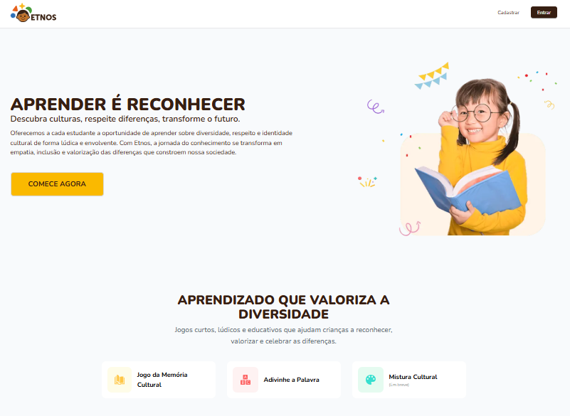

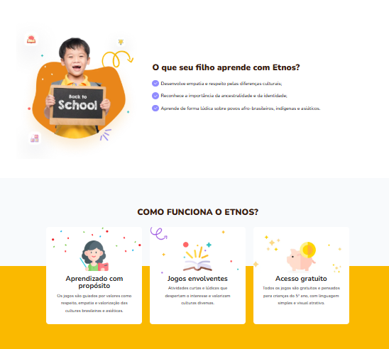

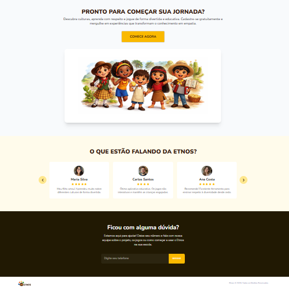

#### Página de cadastro (Comece agora)

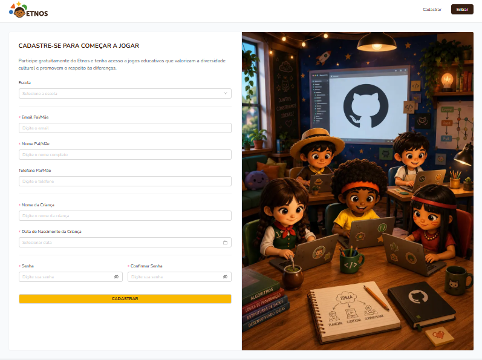

#### Página de login

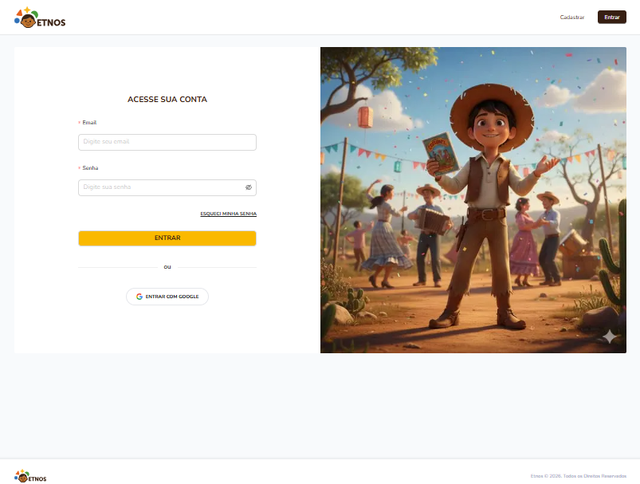

#### Área do estudante (home)

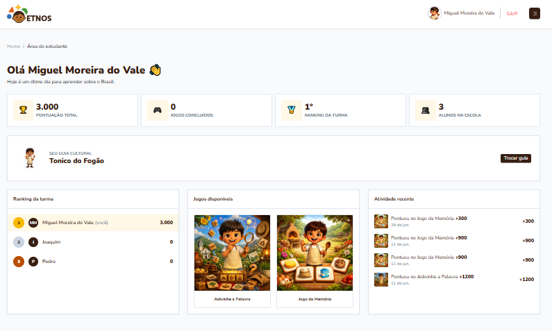

#### Jogo Adivinhe a Palavra

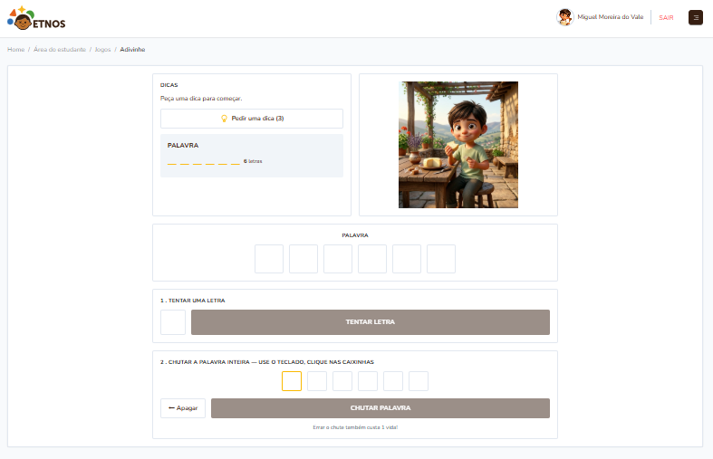

#### Jogo da Memória

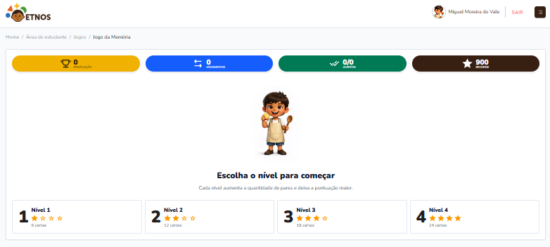

#### Jogo da Memória – Nível 1

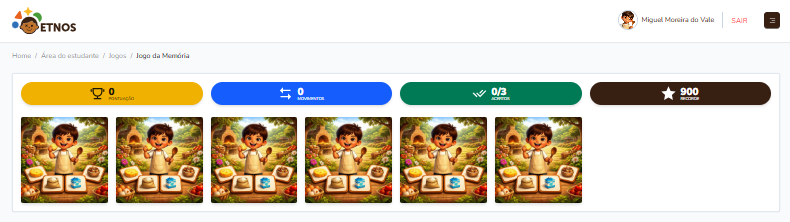

#### Jogo da Memória – Nível 2

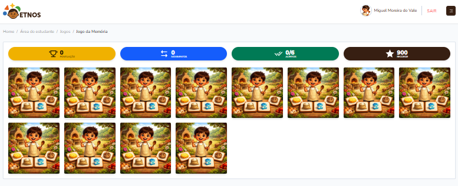

#### Jogo da Memória – Nível 3

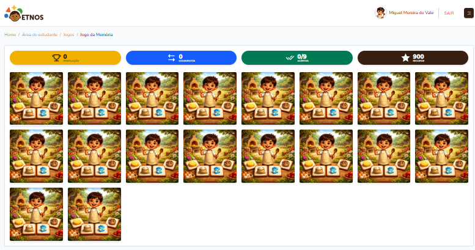

#### Jogo da Memória – Nível 4

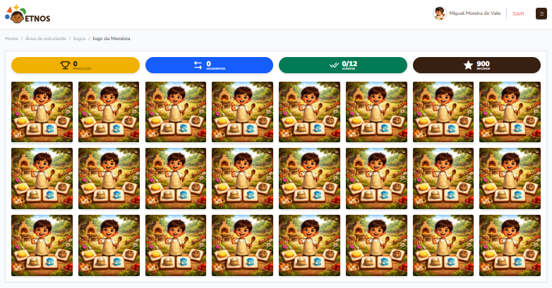

### 3.1 Descrição dos principais produtos e serviços

A ETNOS caracteriza-se como uma plataforma digital de jogos educacionais voltada ao apoio pedagógico
de instituições de ensino, professores e alunos, com ênfase na valorização da cultura
afro-brasileira e indígena. O principal produto oferecido é o acesso à plataforma, composta por
jogos interativos elaborados a partir de critérios pedagógicos definidos por uma equipe
especializada em educação, com temas e conteúdos selecionados e orientados de acordo com as
necessidades curriculares de cada faixa etária e etapa de ensino. A experiência é estruturada em
duas frentes de uso, conforme o perfil do usuário:

#### Para o aluno (experiência gamificada):

- Minijogos interativos guiados por avatares regionais — Iara, Dandara, Anita, Zeca e Tonico —, como o Jogo da Memória Cultural e o Adivinhe a Palavra;

- Jornada de progresso com pontuação, desbloqueio de conteúdo e acompanhamento de desempenho;

- Cadastro simplificado, mediado por responsáveis, com onboarding guiado.

O acesso do aluno à plataforma é gratuito — o custo é absorvido integralmente pela instituição de
ensino contratante, conforme o modelo de licenciamento institucional descrito na seção 3.2, o que
garante que nenhuma criança ou família precise pagar diretamente para utilizar o Etnos.

#### Para a escola (gestão pedagógica):

- Painel administrativo com dashboard de desempenho por aluno e por turma;

- Filtros por escola, ranking de engajamento e relatórios de progresso pedagógico;

- Suporte à adequação às Leis nº 10.639/03 e nº 11.645/08 e à BNCC (Competências 5 e 9).

Além do acesso à plataforma, a empresa oferece como serviços complementares a adaptação de conteúdos
regionais, o treinamento pedagógico voltado às instituições parceiras e o suporte técnico contínuo.
Como garantias, a ETNOS assegura a disponibilidade da plataforma, a conformidade com a Lei Geral de
Proteção de Dados (LGPD) no tratamento de dados de menores, e a atualização contínua de conteúdo
pedagógico, validado por especialistas em cultura afro-brasileira e indígena. A qualidade do produto
está diretamente associada à experiência do usuário final — professores e estudantes —, sendo
constantemente avaliada e aprimorada a partir do retorno das instituições parceiras, de modo a
assegurar que os jogos permaneçam alinhados tanto aos objetivos pedagógicos quanto às expectativas
de uso da plataforma.

### 3.2 Preço

Por se tratar de um serviço (SaaS) e não de um produto físico, o preço da Etnos será estruturado
como **licenciamento por escola/rede de ensino**, e não por unidade vendida. Modelo sugerido:

- **Plano Institucional (B2B):** assinatura anual ou semestral por escola/rede municipal, com valor escalonado pelo número de alunos ativos;

- **Plano via editais/fomento:** para o piloto e fase inicial, a entrada de receita não vem de venda direta, mas de subvenções e editais de inovação educacional (conforme já previsto na seção de capital social), o que permite oferecer acesso gratuito ou subsidiado a escolas públicas nessa fase;

- **Referência de mercado:** como não há concorrente direto comercial (ver Análise de Mercado), o preço será calibrado com base no benchmark de edtechs de gestão pedagógica (SAS, Eleva, Google for Education), ajustado para o poder de compra de redes públicas.

O preço final será detalhado no Plano Financeiro, junto ao cálculo de faturamento e ponto de
equilíbrio.

### 3.3 Estratégias promocionais

Como o cliente institucional é a escola/secretaria de educação, a promoção da Etnos será concentrada
em canais educacionais e institucionais, não em publicidade de massa:

- **Parcerias institucionais:** aproximação direta com secretarias municipais de educação e NEABs;

- **Participação em editais e eventos de inovação educacional:** feiras de EdTech, editais de fomento (alinhados ao ODS 4 e ODS 10) e eventos acadêmicos;

- **Marketing digital direcionado:** redes sociais voltadas a educadores (Instagram/LinkedIn de professores e coordenadores pedagógicos), conteúdo sobre ERER e BNCC;

- **Prova social:** uso dos resultados do piloto (dados de engajamento e depoimentos de professores) como material de divulgação para novas escolas;

- **Apresentações institucionais:** material de pitch (slide com lineup de personagens) para reuniões com gestores escolares.

### 3.4 Estrutura de comercialização (Praça)

A distribuição do Etnos é 100% digital, sem intermediários físicos:

- **Canal direto:** contato comercial direto com escolas e secretarias de educação, feito pela própria equipe fundadora (venda consultiva, típica de EdTech B2B em fase inicial);

- **Onboarding self-service:** cadastro de alunos via URL específica por escola, o que reduz fricção de implantação e dispensa infraestrutura local;

- **Escalabilidade:** por rodar em arquitetura em nuvem (Vercel, Google Cloud Run, NeonDB, Firebase), a expansão para novas escolas não exige logística de entrega ou estoque — apenas ativação de acesso.

### 3.5 Localização do negócio

Na fase piloto (Ano 1), a ETNOS opera de forma remota, com base de origem em Pinhais, Paraná, onde o
projeto nasceu e realizou seus primeiros testes em campo.

A partir do Ano 2, a empresa passa a contar com sede física própria, localizada em **Rua Humberto de
Alencar Castelo Branco, nº 1575, Bairro Jardim Amélia, Pinhais/PR, CEP 83330-200,** escolhida pela
proximidade com a rede de ensino municipal de Pinhais (base do piloto) e pelo fácil acesso à região
metropolitana de Curitiba, facilitando reuniões presenciais com secretarias de educação e
investidores.

## 4. PLANO OPERACIONAL

### 4.1 Layout ou arranjo físico

Na fase piloto (Ano 1), a operação permanece remota e enxuta, conduzida pelos dois sócios fundadores
a partir de suas próprias estruturas, sem custo de locação — modelo compatível com a validação de
mercado em pequena escala descrita na seção 4.2.

A partir do Ano 2, com o avanço da fase piloto para a comercialização em escala (seção 4.4), a ETNOS
passa a operar em sede física própria, com área aproximada de 150 m² (15,64 m x 9,87 m) em
Pinhais/PR, organizada para atender tanto às necessidades internas da equipe quanto ao
relacionamento institucional com investidores, apoiadores e contratantes:

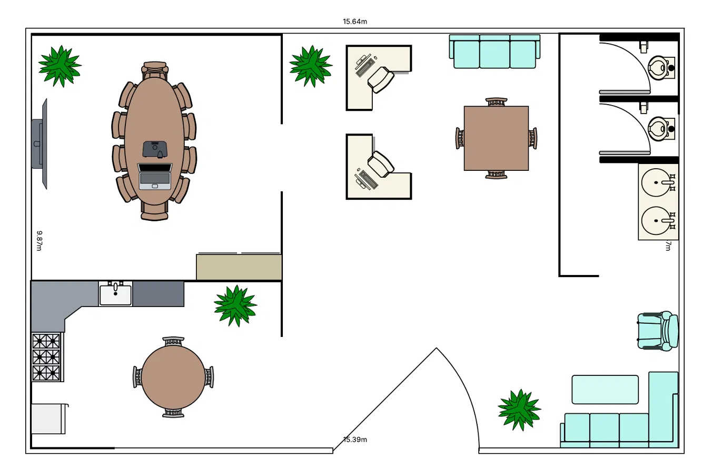

- **Sala de reuniões institucional:** ambiente principal, equipado com mesa oval para até 8 pessoas, TV, projetor e notebook para apresentações,destinada a reuniões com investidores, apoiadores (NEABs, secretarias de educação) e escolas/redes de ensino interessadas na contratação da plataforma.

- **Estações de trabalho dos sócios:** duas baias individuais equipadas com mesa, computador e cadeira, destinadas ao desenvolvimento de software, gestão de produto e operação técnica, conforme funções descritas na seção 4.4;

- **Mesa de apoio (reunião secundária):** mesa quadrada para reuniões internas, alinhamentos de sprint (dailys, retrospectivas) ou encontros menores com fornecedores de conteúdo pedagógico;

- **Copa:** espaço compacto para uso da equipe;

- **Área de recepção/lounge:** conjunto de sofás próximo à entrada, para acomodar visitantes antes das reuniões, reforçando a apresentação institucional da empresa;

- **Sanitários.**

A operação da plataforma é baseada em infraestrutura de nuvem gerenciada. A sede física, a partir do
Ano 2, passa a ser o endereço fiscal da empresa e o ponto de apoio institucional para negociações
com o setor público e captação de recursos.

### 4.2 Capacidade produtiva, comercial e de prestação de serviços

A capacidade da Etnos é medida em número de escolas e alunos ativos simultâneos, e não em unidades
produzidas:

- **Capacidade atual (fase piloto):** validada com testes reais em turma de escolas em Pinhais/PR, incluindo cenário de acesso concorrente (que já revelou e resolveu um gargalo real de limite de conexões do banco de dados);

- **Capacidade técnica de escala:** a arquitetura serverless (Cloud Run "escala a zero", Vercel e Firebase gerenciados) permite crescimento horizontal sem redesenho da infraestrutura, bastando ajustes de plano/pooling à medida que a base de usuários cresce;

- **Capacidade comercial:** limitada, na fase atual, pela capacidade de atendimento comercial e suporte pedagógico da própria equipe fundadora — ou seja, o gargalo inicial não é tecnológico, e sim de força de trabalho para prospecção, onboarding e suporte às escolas.

### 4.3 Processos operacionais

O Etnos opera com metodologia ágil (Scrum), o que estrutura tanto o desenvolvimento do produto
quanto a operação do negócio:

- **Ciclo de desenvolvimento:** sprints quinzenais, com reuniões diárias (dailys), backlog priorizado no ClickUp e Definição de Pronto (DoD) antes da entrega de cada história;

- **Qualidade e estabilidade:** pipeline de CI/CD com análise estática de código (SonarCloud), monitoramento de erros em produção (Sentry) e acompanhamento de jornada do usuário (Mixpanel);

- **Processo de entrada de cliente (onboarding institucional):** cadastro da escola no painel administrativo → geração de link/código de acesso próprio da escola → cadastro simplificado dos alunos mediado por responsáveis → acompanhamento via dashboard pedagógico;

- **Processo de suporte e evolução de conteúdo:** revisão contínua do conteúdo pedagógico dos jogos (com validação de adequação cultural e etária), tratamento de incidentes técnicos e atualização de funcionalidades a partir do feedback coletado em campo.

### 4.4 Necessidade de Pessoal

Na fase atual, o projeto é operado por uma equipe enxuta e multifuncional, formada pelos dois sócios
fundadores, que acumulam funções de desenvolvimento, gestão de produto e operação técnica. À medida
que o negócio evoluir da fase piloto para comercialização em escala, a necessidade de pessoal deve
ser ampliada:

| Função | Fase atual | Necessidade futura |
| --- | --- | --- |
| Desenvolvimento (full-stack/mobile) | Sócios fundadores | Contratação ou terceirização conforme crescimento da base de escolas |
| Gestão de produto/ operações | Sócios fundadores | Mantido pelos sócios, com possível dedicação exclusiva |
| Conteúdo pedagógico | Consultoria pontual | Especialista(s) em história/cultura afro-brasileira e indígena para validação contínua |
| Comercial/relacionamento com escolas | Sócios fundadores | Responsável comercial dedicado à prospecção de redes municipais/estaduais |
| Suporte técnico ao cliente | Sócios fundadores | Suporte dedicado à medida que o número de escolas ativas crescer |

Esse dimensionamento é compatível com o modelo lean startup descrito no Sumário Executivo, evitando
custo fixo elevado com folha de pagamento antes da validação comercial em escala.

## 5 PLANO FINANCEIRO

### 5.1 Investimentos

O investimento inicial da ETNOS ocorre em dois momentos, alinhados ao avanço da fase piloto para a
comercialização em escala.

#### Investimento pré-operacional (Ano 1 — fase piloto):

| Item | Natureza | Valor (R$) |
| --- | --- | --- |
| Ativos intangíveis (PI e horas técnicas de desenvolvimento) | Pré-operacional | 15.000,00 |
| Capital de giro inicial (domínio, nuvem excedente, materiais) | Pré-operacional | 1.000,00 |
| **Total Ano 1** | - | **16.000,00** |

#### Investimento de expansão (Ano 2 — implantação da sede física):

| Item | Natureza | Valor (R$) |
| --- | --- | --- |
| Mobiliário e adequação do espaço | Expansão | 25.000,00 |
| Caução do imóvel (3x aluguel) | Expansão | 10.500,00 |
| **Total Ano 2** | - | **35.500,00** |

O investimento total ao longo dos dois primeiros anos soma R$51.500,00. Como o resultado acumulado
do Ano 1 (R$ 1.980,00) é insuficiente para cobrir a expansão, a implantação da sede física depende
de recursos adicionais — aporte complementar dos sócios, linha de crédito para pequenas empresas
(ex.: PRONAMPE) ou captação de edital específico de infraestrutura —, a serem captados ao final do
Ano 1, com base nos resultados já validados no piloto.

### 5.2 Composição dos principais gastos

#### Custos fixos mensais - Ano 1 (Operação remota):

|**Item**|**Valor mensal**|
|---|---|
|Pró-labore dos sócios (2 sócios)|R$1.500,00|
|Serviços contábeis (contador terceirizado)|R$200,00|
|Domínio e certificado digital (etnos.online)|R$10,00|
|Ferramentas de gestão e monitoramento (ClickUp, Sentry, Mixpanel)|R$0,00|
|**Total de custos fixos ano 1**|**R$1.710,00**|

#### Custos fixos mensais — Ano 2 (implantação de sede física):

|**Item**|**Valor mensal**|
|---|---|
|Pró-labore dos sócios (2 sócios)|R$1.500,00|
|Serviços contábeis (contador terceirizado)|R$200,00|
|Domínio e certificado digital (etnos.online)|R$10,00|
|Ferramentas de gestão e monitoramento (ClickUp, Sentry, Mixpanel)|R$0,00|
|Aluguel de imóvel para sede física (150 m²)|R$3.500,00|
|Condomínio|R$450,00|
|IPTU (rateio mensal)|R$120,00|
|Água|R$150,00|
|Energia elétrica|R$300,00|
|Internet empresarial|R$200,00|
| **Total de custos fixos** | **R$6.430,00** |

#### Custos variáveis (crescem conforme o número de escolas/alunos ativos):

| Item | Comportamento |
| --- | --- |
| Infraestrutura em nuvem excedente ao tier gratuito (Cloud Run, NeonDB) | Pay-per-use, crescente com o volume de acessos simultâneos |
| Consultoria pedagógica pontual (validação de conteúdo ERER) | Contratada sob demanda, conforme expansão do catálogo de jogos |
| Comissionamento/apoio comercial (a partir da fase de expansão) | Proporcional ao número de novos contratos institucionais fechados |

À medida que a operação avança da fase piloto para a fase de comercialização em escala (Ano 2 em
diante), espera-se um aumento gradual dos custos fixos, decorrente da contratação de um responsável
comercial e da ampliação do suporte técnico às escolas parceiras, conforme já projetado na seção 4.4
(Necessidade de Pessoal).

### 5.3 Evolução dos resultados econômicos e financeiros (projetados).

O Ano 2 passa a apresentar resultado negativo — o custo da sede física absorve a margem de
contribuição gerada pelo crescimento da base de escolas antes que a receita de licenciamento
amadureça o suficiente para cobri-lo e a recuperação ocorre somente no Ano 3.

| Indicador | Ano 1 (piloto) | Ano 2 | Ano 3 |
| --- | --- | --- | --- |
| Escolas parceiras | 5 | 30 | 80 |
| Alunos ativos | 150 | 3.000 | 10.000 |
| Receita de licenciamento | R$4.500,00 | R$90.000,00 | R$300.000,00 |
| Receita de editais/subvenções e serviços | R$20.000,00 | R$15.000,00 | R$20.000,00 |
| **Receita bruta total** | **R$24.500,00** | **R$105.000,00** | **R$320.000,00** |
| Custos e despesas totais | R$22.520,00 | R$143.640,00 | R$276.640,00 |
| **Resultado do exercício** | **R$1.980,00** | **-R$38.640,00** | **R$43.360,00** |
| Margem líquida | 8,1% | -36,8% | 13,5% |

### 5.4 Capital de giro

O capital de giro da ETNOS destina-se a cobrir as despesas operacionais correntes nos períodos em
que as entradas de receita — sobretudo os recursos de editais e os primeiros contratos
institucionais — ainda não estão consolidadas em fluxo contínuo. Como o patamar de custos fixos muda
significativamente entre o Ano 1 (operação remota) e o Ano 2 (sede física), a reserva recomendada
também precisa ser dimensionada em dois momentos.

#### Ano 1 (piloto, operação remota):

Considerando o custo fixo mensal de R$ 1.710,00, recomenda-se uma reserva mínima equivalente a três
meses de operação, o que representa aproximadamente **R$ 5.130,00**. O aporte em espécie previsto
no capital social inicial (R$ 1.000,00, seção 1.9.3) cobre parte dessa necessidade; o restante deve
ser constituído a partir das primeiras entradas de recursos de editais e subvenções, em linha com o
modelo de autofinanciamento (bootstrapping) adotado nessa fase.

#### A partir do Ano 2 (sede física):

Com o custo fixo mensal subindo para R$6.430,00, a reserva de segurança recomendada — mantendo o
parâmetro de três meses — sobe para aproximadamente **R$19.290,00**. Esse valor é
significativamente maior do que o previsto no investimento de expansão (seção 5.1), que contempla
apenas a caução do imóvel (R$10.500,00) e o mobiliário (R$25.000,00), sem reserva de capital de giro
dedicada.

Isso significa que os R$35.500,00 previstos para a implantação da sede física **não são
suficientes** se a empresa também precisar constituir a reserva de capital de giro do Ano 2 ao mesmo
tempo. Recomenda-se, portanto, que a captação de recursos-ponte mencionada na seção 7 (aporte
complementar, PRONAMPE ou edital de infraestrutura) contemple um valor adicional de pelo menos R$
19.290,00, elevando a necessidade real de captação para a transição de fase para algo próximo de
**R$ 55.000,00**, e não apenas os R$ 35.500,00 de investimento direto na sede.

### 5.5 Indicadores de viabilidade

Para avaliar a viabilidade financeira do negócio, foram calculados três indicadores centrais: o
ponto de equilíbrio operacional, o prazo de payback do investimento inicial e a evolução da margem
líquida ao longo do período projetado.

**Ponto de equilíbrio (break-even)**

- Ano 1 (custo fixo R$1.710,00): ~684 alunos ativos pagantes, como já calculado — não atingido no piloto (150 alunos), compensado por recursos de editais.

- A partir do Ano 2 (custo fixo R$6.430,00): o ponto de equilíbrio sobe para **~2.572 alunos ativos** (aproximadamente 51 escolas de porte médio).

#### Payback do investimento:

Considerando o investimento total de R$ 51.500,00 (R$ 16.000,00 no Ano 1 + R$ 35.500,00 no Ano 2) e
o resultado acumulado projetado (R$ 1.980,00 no Ano 1, -R$ 38.640,00 no Ano 2 e R$ 43.360,00 no Ano
3, totalizando R$ 6.700,00 acumulados), **o payback ultrapassa o horizonte de três anos projetado
neste plano**. Isso reforça a necessidade de captação de recursos-ponte (edital ou aporte) para
sustentar o Ano 2 e de reavaliação do ritmo de expansão física, caso a adoção comercial fique abaixo
do cenário realista.

#### Evolução da margem líquida:

A margem deixa de ser crescente e linear (8,1% → 17,1% → 31,3%) e passa a ter formato de "vale":
positiva no Ano 1, negativa no Ano 2 (-36,8%) e voltando a positiva no Ano 3 (13,5%) — refletindo o
impacto temporário do custo fixo da sede sobre um negócio ainda em fase de maturação comercial

### 5.6 Cenários Alternativos

Com a sede física incorporada aos custos fixos, o **cenário pessimista deixa de ser resiliente**: o
que antes era um resultado positivo (R$27.000,00) passa a operar no prejuízo (-R$29.640,00). Isso é
um risco relevante a ser destacado na análise estratégica — a estrutura física própria melhora a
credibilidade institucional, mas reduz a margem de segurança do negócio em cenários de baixa adoção
comercial.

|**Cenário**|**Premissas** **principais**|**Alunos ativos** **(Ano 3)**|**Receita** **(Ano 3)**|**Resultado** **(Ano 3)**|
|---|---|---|---|---|
|Otimista|Adoção acelerada via parcerias com secretarias estaduais e editais federais de maior porte|25.000|R$ 750.000,00|R$173.360,00|
|Realista (base)|Crescimento gradual descrito na seção 5.3, ciclo de vendas B2B público padrão|10.000|R$ 320.000,00|R$43.360,00|
|Pessimista|Baixa adesão comercial e não renovação de editais; equipe permanece restrita aos sócios fundadores|1.500|R$ 55.000,00|-R$ 29.640,00|

## 6. ANÁLISE ESTRATÉGICA

### 6.1 Análise SWOT

A análise SWOT sintetiza os principais fatores internos (forças e fraquezas) e externos
(oportunidades e ameaças) que influenciam a viabilidade estratégica da ETNOS, com base nas
informações levantadas nas seções de Análise de Mercado e Plano Financeiro.

|**Forças**|**Fraquezas**|
|---|---|
|• Pioneirismo em um nicho de mercado ainda não explorado comercialmente (ensino gamificado de ERER); • Arquitetura de infraestrutura em nuvem de custo quase zero, permitindo margens crescentes; • Equipe fundadora multidisciplinar (pedagogia e tecnologia) alinhada ao propósito do negócio; • Aderência direta às Leis nº 10.639/03 e nº 11.645/08 e à BNCC, o que facilita a justificativa de compra pelo cliente institucional; • Validação já realizada em campo, com testes reais em escolas de Pinhais/PR. • Estrutura física profissional (sala de reuniões, estações de trabalho), que fortalece a credibilidade institucional em negociações presenciais com investidores, secretarias de educação e parceiros de fomento.|• Equipe pequena, concentrada nos dois sócios fundadores, com acúmulo de funções; • Marca ainda pouco reconhecida no mercado de edtechs; • Dependência inicial de capital próprio e de editais para sustentar a fase pré-comercial; • Ciclo de vendas B2B junto ao setor público, potencialmente mais lento e burocrático. • Custo fixo elevado a partir do Ano 2 com a sede física própria (aluguel, condomínio, contas de consumo), que eleva significativamente o ponto de equilíbrio e reduz a resiliência financeira do negócio em cenários de adoção comercial mais lenta, podendo levar a resultado negativo mesmo em fase avançada de operação.|

| Oportunidades | Ameaças |
| --- | --- |
| • Crescimento do mercado brasileiro de edtechs, líder na América Latina no setor; • Ampliação de editais e políticas públicas de fomento à tecnologia educacional e à educação étnico-racial; • Ausência de concorrente direto especializado no nicho de ERER gamificado; • Alinhamento aos ODS 4 e 10 da Agenda 2030, fator atrativo para financiadores e programas de impacto social. | • Possível entrada de grandes players de edtech no nicho, uma vez validado comercialmente; • Dependência de provedores de infraestrutura em nuvem terceirizados (Vercel, Google Cloud, NeonDB, Firebase) e de eventuais mudanças em suas políticas de preço; • Morosidade nos processos de compra e contratação do setor público; • Mudanças em políticas educacionais que possam afetar a obrigatoriedade curricular vigente. |

## 7. AVALIAÇÃO DO PLANO

Com base nos elementos levantados ao longo deste Plano de Negócio, a ETNOS apresenta-se como um
projeto estrategicamente viável, ainda que com uma trajetória financeira menos linear do que a
inicialmente prevista, em razão da decisão de estruturar sede física própria a partir do Ano 2 de
operação.

O Ano 1, conduzido de forma remota e enxuta pelos próprios sócios fundadores, mantém a lógica de
bootstrapping: investimento inicial baixo (R$ 16.000,00, majoritariamente ativos intangíveis já
desenvolvidos) e resultado levemente positivo (R$ 1.980,00), sustentado por recursos de editais
durante a fase de validação de mercado. Esse período cumpre seu papel de testar a solução em campo —
como já demonstrado nos testes reais em escolas de Pinhais/PR — e de gerar evidências (dados de
engajamento, depoimentos de professores) para sustentar tanto a expansão comercial quanto a captação
de recursos necessários à etapa seguinte.

A partir do Ano 2, com a implantação da sede física (investimento adicional de R$ 35.500,00), a
empresa passa por um período de resultado negativo (-R$ 38.640,00), decorrente do salto nos custos
fixos mensais — de R$ 1.710,00 para R$ 6.430,00 — antes que a receita de licenciamento institucional
amadureça o suficiente para absorvê-los. O ponto de equilíbrio sobe de aproximadamente 684 para
2.572 alunos ativos, patamar que a empresa só deve atingir ao longo do Ano 3, quando o resultado
volta a ser positivo (R$ 43.360,00, margem líquida de 13,5%).

Consequentemente, **o payback do investimento total (R$51.500,00) ultrapassa o horizonte de três
anos** projetado neste plano — o resultado acumulado ao final do Ano 3 soma apenas R$6.700,00, muito
aquém do valor investido. Esse é o principal ponto de atenção da análise financeira: a decisão de
investir em estrutura física própria melhora a credibilidade institucional da ETNOS perante
investidores, secretarias de educação e parceiros de fomento, mas reduz significativamente a
resiliência do negócio, sobretudo em cenários de adoção comercial mais lenta. No cenário pessimista
(seção 5.6), por exemplo, o resultado do Ano 3 passa a ser negativo (-R$ 29.640,00), o que não
ocorria na versão do plano sem sede física.

Diante disso, a viabilidade da ETNOS passa a depender de três fatores críticos, que serão
monitorados de perto pelos sócios:

1. **Captação de recursos-ponte para o Ano 2** — seja por aporte complementar dos sócios, linha de
crédito para pequenas empresas (ex.: PRONAMPE) ou edital específico de infraestrutura, já que o
resultado acumulado do Ano 1 não é suficiente para cobrir a implantação da sede física;

2. **Ritmo de adoção comercial compatível com o cenário realista ou superior** (seção 5.6), uma vez
que o cenário pessimista deixa de ser sustentável com a nova estrutura de custos;

3. **Disciplina na transição entre fases** — a decisão de avançar para a sede física ao final do Ano
1 deve ser condicionada aos resultados efetivos do piloto (número de escolas parceiras, engajamento
validado, editais captados), e não apenas ao cronograma originalmente projetado, para evitar
comprometer o caixa da empresa antes da adoção comercial estar de fato consolidada.

Os demais riscos identificados na análise SWOT — ciclo de vendas junto ao setor público, dependência
de provedores de infraestrutura terceirizados e possível entrada de concorrentes de maior porte
permanecem válidos e se somam ao novo risco de estrutura de custos fixos elevada. Recomenda-se,
ainda, atenção contínua ao Fator R (seção 1.8) para otimização tributária conforme a folha de
pagamento evolui, e a constituição de uma reserva de capital de giro ampliada (seção 5.4),
proporcional ao novo patamar de custos fixos a partir do Ano 2.

Diante do exposto, considera-se que a ETNOS reúne condições estratégicas e operacionais para avançar
da fase de piloto para a fase de comercialização, mas sua viabilidade financeira nos moldes atuais
está condicionada à captação de recursos complementares para o Ano 2 e a um ritmo de adoção
comercial próximo ou superior ao cenário realista projetado — sem os quais a estruturação de sede
física própria representa um risco relevante à sustentabilidade do negócio no curto prazo.

## REFERÊNCIAS

BRASIL. Conselho Nacional de Educação. **Resolução CNE/CP nº 1, de 17 de junho de 2004**. Institui
Diretrizes Curriculares Nacionais para a Educação das Relações Étnico-Raciais e para o Ensino de
História e Cultura Afro-Brasileira e Africana. Brasília, DF: CNE, 2004. Disponível em:

<https://www.gov.br/mec/pt-br/cne/pdf/resolucoes-do-cne/cp/2004/res012004.pdf>. Acesso em: 16 mar.
2026.

BRASIL. **Lei nº 10.639, de 9 de janeiro de 2003**. Altera a Lei nº 9.394, de 20 de dezembro de
1996, para incluir no currículo oficial da Rede de Ensino a obrigatoriedade da temática "História e
Cultura Afro-Brasileira", e dá outras providências. Diário Oficial da União, Brasília, DF, 10 jan.
2003. Disponível em: <https://www.planalto.gov.br/ccivil_03/leis/2003/l10.639.htm>. Acesso em: 16 mar.
2026.

BRASIL. **Lei nº 11.645, de 10 de março de 2008**. Altera a Lei nº 9.394, de 20 de dezembro de
1996, modificada pela Lei nº 10.639, de 9 de janeiro de 2003, que estabelece as diretrizes e bases
da educação nacional, para incluir no currículo oficial da Rede de Ensino a obrigatoriedade da
temática "História e Cultura Afro-Brasileira e Indígena". Diário Oficial da União, Brasília, DF, 11
mar. 2008. Disponível em: <https://www.planalto.gov.br/ccivil_03/_ato2007-2010/2008/lei/l11645.htm>.
Acesso em: 16 mar. 2026.

BRASIL. Ministério da Educação. **Base Nacional Comum Curricular**. Brasília: MEC, 2018. Disponível
em: <https://basenacionalcomum.mec.gov.br/abase/>. Acesso em: 15 mar. 2026.

ORGANIZAÇÃO DAS NAÇÕES UNIDAS. **Sobre o nosso trabalho para alcançar os Objetivos de
Desenvolvimento Sustentável no Brasil**. Disponível em: <https://brasil.un.org/pt-br/sdgs>. Acesso
em: 10 mar. 2026.

SILVA, Ana Tereza Reis da; ALMEIDA, Bárbara Ribeiro Dourado Pias de; LIMA, Lurian José Reis da
Silva. Avanços e desafios na implementação da educação antirracista no Brasil. **Educação em Revista**, Belo Horizonte, v. 41, p. e48326, 2025. Disponível em:
<https://doi.org/10.1590/0102-469848326>. Acesso em: 15 mar. 2026.

SOUSA, D. B. N. **Utilização de jogos educativos digitais no processo ensino-aprendizagem**. 2017.
Trabalho de Conclusão de Curso (Graduação em Pedagogia) – Universidade Federal da Paraíba, João
Pessoa, 2017. Disponível em: <https://repositorio.ufpb.br/jspui/handle/123456789/15753>. Acesso em: 20
mar. 2026.
